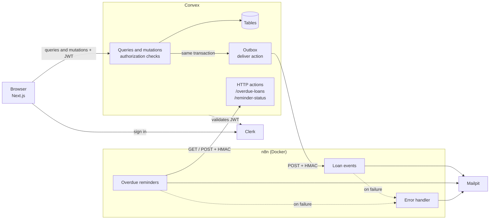

# LendLoop

**Borrow what you need. Lend what you don't.**

A neighborhood tool-lending board. Neighbors list tools, request to borrow them for a date range, and get automated notifications and overdue reminders handled by n8n.

Built as the Fluence take-home assignment, with an emphasis on authorization enforced in the backend, a signed and idempotent integration with n8n, and minimal data sharing.

## Stack

| Layer | Technology |
| --- | --- |
| Frontend | Next.js 16 (App Router, Cache Components), TypeScript, Tailwind CSS |
| Auth | Clerk (Convex integration, custom session claims) |
| Backend and data | Convex (local deployment) |
| Automation | n8n 2.46.6, self-hosted with Docker Compose |
| Email (local) | Mailpit, a local SMTP server with a web inbox |

## Features

- **Public page:** tagline, a read-only list of available tools (name and category only) and a "Sign in to lend or borrow" button wired to Clerk.
- **Signed-in users:** list, edit and remove their own tools; browse all tools with availability and a category filter; request a tool for a date range; approve or decline requests on their own tools; mark loans as returned.
- **Views:** Tools, My listings, My requests, Incoming requests.
- **Admin:** remove any listing, view all loans (paginated), mark a lender as Trusted Lender.
- **Automation:** request and status notifications, a daily overdue reminder, and an error workflow that alerts on any failed run.
- **Bonus:** recent automation activity on each loan, for example "Reminder sent 2 days ago" or "Approval notification retrying (attempt 2)".

## Quick start

**Prerequisites:** Node.js 20.9+ (22 recommended), Docker Desktop, a free Clerk account.

### 1. Install

```bash
git clone <repo-url> lendloop
cd lendloop
npm install
```

### 2. Configure Clerk

1. Create an application in the [Clerk dashboard](https://dashboard.clerk.com) (Consumer, with Email and optionally Google).
2. **Configure → Integrations → Convex:** activate the integration and copy the **Frontend API URL**.
3. **Configure → Sessions → Customize session token:** add these claims so Convex receives the user's email and name:

   ```json
   {
     "email": "{{user.primary_email_address}}",
     "name": "{{user.full_name}}"
   }
   ```

4. Copy `.env.local.example` to `.env.local` and fill in `NEXT_PUBLIC_CLERK_PUBLISHABLE_KEY` and `CLERK_SECRET_KEY` from **Configure → API keys**.

### 3. Start Convex (local deployment)

```bash
npx convex dev
```

Choose **Start without an account (run Convex locally)**. Keep this terminal running. It fills the `CONVEX_*` lines in `.env.local`.

In a second terminal, generate two **different** secrets (run twice):

```bash
node -e "console.log(require('crypto').randomBytes(32).toString('hex'))"
```

Then set the Convex environment:

```bash
npx convex env set CLERK_JWT_ISSUER_DOMAIN https://<your-instance>.clerk.accounts.dev
npx convex env set CONVEX_TO_N8N_SECRET <secret-1>
npx convex env set N8N_TO_CONVEX_SECRET <secret-2>
npx convex env set N8N_LOAN_EVENTS_WEBHOOK_URL http://localhost:5678/webhook/lendloop-loan-events
```

### 4. Start n8n and Mailpit

Copy `.env.example` to `.env` and fill it with the **same two secrets** plus a third one for `N8N_ENCRYPTION_KEY`. Then:

```bash
docker compose up -d
```

- n8n: <http://localhost:5678> (create the local owner account)
- Mailpit inbox: <http://localhost:8025>

### 5. Import the workflows

```bash
docker compose exec n8n n8n import:workflow --separate --input=/home/node/workflows
```

Then, in n8n:

1. Create an **SMTP** credential named `Mailpit SMTP`: host `mailpit`, port `1025`, no user or password, SSL/TLS off.
2. Open each workflow and select that credential in its **Send Email** node. Imported workflows only reference credentials by name and ID, never by content, so this step is required.
3. Publish **LendLoop: Error handler** first, then **LendLoop: Loan events** and **LendLoop: Overdue reminders**. Check that both point to the Error handler in **Settings → Error workflow**.

### 6. Run the app

```bash
npm run dev
```

Open <http://localhost:3000>. To test, sign up with two accounts (a normal window and a private window).

To make one of them an admin, open the Convex dashboard (`npx convex dashboard`), go to **Functions → `users:setRole`** and run it with `{"email": "you@example.com", "role": "admin"}`. Roles can only be changed this way, never from the app.

### 7. Optional: test the overdue reminder

```bash
npx convex run seed:overdueLoan
```

This creates an approved loan that ended two days ago (the app itself rejects past dates). Then run **LendLoop: Overdue reminders** in n8n and check Mailpit.

## Environment variables

| Variable | Where it lives | Purpose |
| --- | --- | --- |
| `CONVEX_DEPLOYMENT`, `NEXT_PUBLIC_CONVEX_URL`, `NEXT_PUBLIC_CONVEX_SITE_URL` | `.env.local` (written by `npx convex dev`) | Connect Next.js to the local Convex deployment |
| `NEXT_PUBLIC_CLERK_PUBLISHABLE_KEY` | `.env.local` | Clerk frontend key (public by design) |
| `CLERK_SECRET_KEY` | `.env.local` | Clerk server key (secret) |
| `CLERK_JWT_ISSUER_DOMAIN` | Convex env | Clerk Frontend API URL, used by `convex/auth.config.ts` to validate tokens |
| `CONVEX_TO_N8N_SECRET` | Convex env **and** `.env` | Signs events sent from Convex to n8n |
| `N8N_TO_CONVEX_SECRET` | Convex env **and** `.env` | Signs requests sent from n8n to Convex |
| `N8N_LOAN_EVENTS_WEBHOOK_URL` | Convex env | Production URL of the n8n webhook |
| `N8N_ENCRYPTION_KEY` | `.env` | Encrypts credentials stored by n8n |
| `CONVEX_SITE_URL_FOR_N8N` | `.env` | How the n8n container reaches Convex HTTP actions (`http://host.docker.internal:3211`) |

Each secret must have the same value in both places where it appears, and the two HMAC secrets must differ from each other. All real env files are git-ignored; only the `*.example` files are committed.

## Architecture



The browser only talks to Convex. n8n never touches the database: it receives signed events and answers through two signed HTTP endpoints.

**Life of a borrow request**

1. The borrower clicks **Request**. `loans.request` validates the dates, ownership and conflicts, inserts the loan and a `notificationEvents` row, and schedules delivery, all in one transaction.
2. The `deliver` action builds a minimal payload, signs it and POSTs it to the n8n webhook.
3. n8n verifies the signature and timestamp, skips duplicates, emails the lender and answers `200`.
4. Convex marks the event as `sent`. On any failure it retries with backoff, and the loan shows the current state in the app.

**Daily overdue reminder:** the scheduled workflow signs a `GET /overdue-loans`, emails each borrower, then reports each result to `POST /reminder-status`, which is idempotent.

### Project structure

```text
app/                    pages: public, tools, me/listings, me/requests, me/incoming, admin
components/             ConvexClientProvider, UserSync, Nav, ToolForm, RequestForm, StatusBadge, ActivityLine
hooks/useStoreUser.ts   creates or syncs the Convex user after sign-in
lib/labels.ts           UI labels and user-facing error messages
convex/
  schema.ts             tables and indexes
  auth.config.ts        Clerk as the auth provider
  lib/                  auth helpers, HMAC, date utilities
  users.ts tools.ts loans.ts admin.ts
  notifications.ts      outbox and signed delivery to n8n
  reminders.ts http.ts  overdue endpoint and idempotent write-back
  seed.ts               test data for overdue reminders
n8n/workflows/          exported workflow JSON (no credentials, no execution data)
scripts/                mock-n8n.mjs and sign-request.mjs for testing without n8n
proxy.ts                Clerk middleware (UX redirect only, not a security boundary)
docker-compose.yml      n8n and Mailpit
```

### Data model

| Table | Purpose |
| --- | --- |
| `users` | Convex profile linked to the Clerk identity; `role` (`admin` or `user`) and `trustedLender` |
| `tools` | Listings, with the owner |
| `loans` | Requests and loans: `pending` → `approved` or `declined`, `pending` → `cancelled`, `approved` → `returned` |
| `notificationEvents` | Outbox for events sent to n8n: recipient, status snapshot, attempts, last error |
| `reminders` | One row per loan per day, keyed by `loanId:date` for idempotency |

Availability is computed, not stored: a tool is on loan if an approved loan covers today. This avoids state that can drift.

## Security decisions

### Authorization lives in Convex

Every public Convex function starts with an authorization helper (`requireUser`, `requireAdmin`, `assertSelf`). The UI hiding a button and the Clerk middleware redirecting signed-out visitors are conveniences only; calling a function directly gives the same answer.

- A new user is always created with `role: "user"`. The role can only be changed by `users:setRole`, an internal mutation that cannot be called from the browser.
- `ownerId` and `borrowerId` always come from the authenticated session, never from function arguments.
- Errors use generic codes (`FORBIDDEN`, `NOT_FOUND`, `INVALID_STATE`...) without internal details. The UI maps them to friendly messages.

| Function | Who can call it | Checks |
| --- | --- | --- |
| `tools.listPublic` | Anyone | Returns only available tools, with name and category |
| `tools.list`, `tools.mine` | Signed in | Owner shown as first name and Trusted badge only |
| `tools.create` | Signed in | Owner taken from the session; length limits |
| `tools.update`, `tools.remove` | Owner | Removal blocked while a loan is pending or approved |
| `loans.request` | Signed in, not the owner | Valid range, not in the past, at most 30 days, no conflict with an approved loan, one pending request per tool |
| `loans.cancel` | Borrower | Only while `pending` |
| `loans.decide` | Tool owner | Only while `pending`; conflicts checked again on approval |
| `loans.markReturned` | Tool owner | Only while `approved` |
| `loans.mine`, `loans.incoming` | Signed in | Filtered by the session user |
| `loans.activity` | Owner, borrower or admin | |
| `admin.*` | Admin | Removing a tool cancels its pending requests and notifies the borrowers |

Convex mutations are transactional, so a conflict check and the write that depends on it cannot be interleaved by a concurrent request.

I verified these rules by calling the functions directly from the Convex dashboard while impersonating a regular user: admin functions return `FORBIDDEN`, editing another user's tool returns `FORBIDDEN`, and requesting one's own tool returns `OWN_TOOL`.

### Signed integration in both directions

| Direction | Headers | Signed message |
| --- | --- | --- |
| Convex → n8n | `x-lendloop-timestamp`, `x-lendloop-signature: sha256=<hex>`, `x-lendloop-event-id` | `{timestamp}.{raw body}` |
| n8n → Convex | `x-lendloop-timestamp`, `x-lendloop-signature: sha256=<hex>` | `{timestamp}.{METHOD}.{path}.{raw body}` |

- **HMAC SHA-256** with a separate secret for each direction, so leaking one does not compromise the other.
- **Replay protection:** requests older than 5 minutes are rejected.
- **Constant-time comparison:** `crypto.subtle.verify` in Convex and `crypto.timingSafeEqual` in n8n.
- **Raw bytes:** the signature covers the exact bytes sent. The n8n webhook reads the raw body, and the write-back sends a pre-built raw body instead of letting the HTTP node re-serialize JSON.
- **Method and path are signed** on the n8n → Convex side, so a valid signature for `GET /overdue-loans` cannot be replayed against `POST /reminder-status`.
- **Verify before parsing:** the Convex endpoints check the signature before calling `JSON.parse`, cap the body at 10 KB and validate every field.
- Unsigned or invalid requests get `401` with an empty body.

### Secrets

- No secret is stored in code, in the exported workflow JSON or in the Git history. I checked the exports and ran `git log -p --all -S <prefix>` for each secret.
- Convex reads secrets from its environment; n8n reads the HMAC secrets from container environment variables and SMTP settings from an encrypted n8n credential.
- Exported workflows reference the credential by name and ID only, and contain no pinned execution data.

### Why two n8n settings are relaxed

The Code nodes need Node's `crypto` module and the HMAC secrets, so `docker-compose.yml` sets:

- `NODE_FUNCTION_ALLOW_BUILTIN=crypto`: allows only `crypto`, not every built-in module.
- `N8N_BLOCK_ENV_ACCESS_IN_NODE=false`: n8n 2.x blocks environment access by default. I enabled it to keep the secrets out of the workflow JSON. In production I would load them from a secrets manager through n8n external secrets and turn this back on.

## Data minimization

- **Public page:** only name and category of available tools. No owner information.
- **Other users:** first name and Trusted Lender badge only. Emails are never shown to other users.
- **Convex → n8n payload:** event ID and type, recipient first name and email, tool name, loan dates and status, and the other person's first name. No Clerk IDs, descriptions, conditions or the other person's email.
- **n8n → Convex overdue list:** loan ID, tool name, borrower first name and email, end date and days overdue.
- **Error alerts:** workflow name, execution ID and URL, last node and error message. No payloads or user data.
- **Admin view:** includes emails, because the admin needs to identify users.

## Reliability and error handling

**Convex side (outbox)**

- The event is written in the same transaction as the loan change, so a change can never happen without its notification being queued.
- Delivery has a 10-second timeout and retries with exponential backoff (30 s, 1 min, 2 min, 4 min). After 5 attempts the event is marked `failed`.
- Pending, retrying and failed states are visible on each loan in the app.

**n8n side**

- HTTP and email nodes use **Retry On Fail**.
- The webhook answers explicitly: `401` for an invalid signature, `200` for a duplicate, `200` on success and `500` on failure, so Convex knows when to retry.
- Duplicate events are skipped by `eventId`. The ID is recorded only **after** the email is sent, so a failed attempt can still be retried.
- The reminder write-back is idempotent by `loanId:date`: repeating it never creates a second row, and `sent` is never downgraded to `failed`. Loans already reminded today are excluded from the overdue list.
- Both workflows use an **Error workflow** that emails an alert. n8n only triggers error workflows for production executions, not for manual test runs.

**Simulating failures**

- `docker compose stop n8n`, then approve a request: the loan shows "retrying". `docker compose start n8n` and it becomes "sent" on the next attempt.
- Change `N8N_TO_CONVEX_SECRET` in `.env` and run `docker compose up -d`: the overdue workflow receives `401` and, in a production run, the error alert arrives in Mailpit.

## Testing without n8n

Two small scripts reproduce each side of the integration:

```bash
# receives events from convex, verifies the signature and logs it (FAIL=1 forces 500s)
CONVEX_TO_N8N_SECRET=<secret-1> node scripts/mock-n8n.mjs

# plays the n8n role against the convex endpoints
N8N_TO_CONVEX_SECRET=<secret-2> node scripts/sign-request.mjs overdue
N8N_TO_CONVEX_SECRET=<secret-2> node scripts/sign-request.mjs record <loanId> sent
node scripts/sign-request.mjs unsigned   # expects 401
```

In PowerShell, set the variable first: `$env:CONVEX_TO_N8N_SECRET="..."; node scripts/mock-n8n.mjs`.

## Trade-offs and known limitations

- **Dates are UTC on the server.** Requests accept a start date one day in the past to tolerate users west of UTC, and overdue status is computed in UTC. Per-user time zones would fix this properly
- **Availability is computed at query time.** Convex queries re-run when data changes, not when the clock moves, so "Available" updates on the next change or reload
- **Sending a reminder and recording it are two steps.** If the email is sent but the write-back fails after all retries, a manual re-run the same day could send a second reminder. A claim-then-send step would close this gap
- **n8n duplicate detection** uses workflow static data, which only persists for production executions. The primary guard is Convex marking the event as `sent`
- **Local Convex deployment** was chosen so Convex and n8n can reach each other without a tunnel
- **No automated tests yet.** Everything was verified manually (see above). The next step would be `convex-test` for the authorization rules

## What I would change for production

- Convex and Clerk production instances; n8n behind HTTPS with Postgres, a pinned version and backups of `N8N_ENCRYPTION_KEY`
- HMAC secrets in a secrets manager (for example AWS Secrets Manager or n8n external secrets), with rotation: accept two active secrets during a rollover, identified by a `key-id` header. This also allows re-enabling `N8N_BLOCK_ENV_ACCESS_IN_NODE`
- Claim-then-send for reminders, so a reminder is never sent twice
- A real email provider (SES or Postmark) with SPF and DKIM, notification preferences and unsubscribe
- Rate limiting on mutations, an audit log for admin actions, Sentry on the frontend and backend, alerts on `failed` events and an admin "resend" button
- Retention: delete old events and reminders after a set period
- Automated authorization tests with `convex-test` in CI

## AI assistance

As the assignment allows, I used an AI assistant (Claude) throughout this project.
I set up and configured every service myself, wrote and reviewed the code as it went in, and tested each part by hand, including the security checks described above. I can walk through and explain any part of the code.
